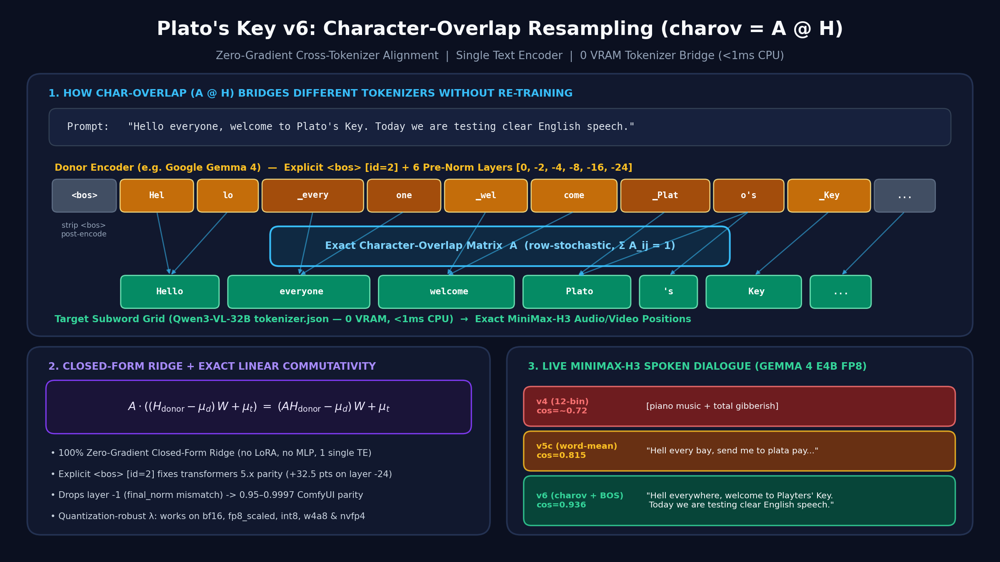

# Plato's Key `v6` — Exact Cross-Tokenizer Speech & Conditioning Alignment (`Char-Overlap A@H` + `BOS-Exact`)

This technical note documents the research and engineering breakthroughs behind **`ComfyUI-H3-Text-Encoders v0.2.0`** and our **`v6` cross-family Plato's Key adapters**, which unlock **intelligible spoken English dialogue on Google Gemma 4 and Inkling-2-Mini inside MiniMax-H3** using **a single text encoder, zero gradient training, zero LoRA, and zero external MLP weights**.

---

## 1. The Cross-Tokenizer Spoken Dialogue Problem

When swapping MiniMax-H3's native `Qwen3-VL-32B` encoder for a **same-tokenizer** donor (`Qwen 3.5` / `Qwen 3.8`), tokens align **1:1** and spoken English dialogue is immediately crystal clear.

When swapping for a **different-tokenizer** family (`Google Gemma 4`, `Inkling-2-Mini`), earlier calibration methods hit a fundamental bottleneck on spoken audio:

| Version | Calibration Alignment | Gemma 4 E4B Live MiniMax-H3 Spoken Dialogue (Whisper Transcript) |
|---|---|---|
| **Target Prompt** | — | `"Hello everyone, welcome to Plato's Key. Today we are testing clear English speech."` |
| `v4` | 12-bin coarse pooling | *(piano music + total gibberish)* |
| `v5c` | Whole-word mean pooling (`offset_mapping`) | `"Hell every bay, send me to plata pay..."` |
| **`v6 BOS-EXACT`** | **Exact Character-Overlap Resampling (`A @ H`)** | **`"Hell everywhere, welcome to Playters' Key. Today we are testing clear English speech."`** |

### Why `v4` and `v5c` Blurred Spoken Syllables
1. **Sequence & Subword Boundary Mismatch:** Gemma 4 and Qwen3-VL split words into different subword counts and boundaries (e.g., `"Plato's"` or `"everyone"`). MiniMax-H3's audio DiT relies on exact subword positions and phonetic cadence in the `Qwen3-VL-32B` token stream.
2. **Whole-Word Pooling Blur (`v5c`):** Averaging all subwords of a word during calibration (`word-mean`) and then applying `W` per-subword at inference created a train/inference mismatch that kept the first syllable intact (`"every-"`, `"plat-"`) while distorting suffixes.

---

## 2. Solution: Deterministic Character-Overlap Resampling (`A @ H`)

Instead of coarse bin pooling or whole-word averaging, **`v6`** aligns donor hidden states **directly onto the exact `Qwen3-VL-32B` subword grid** both during calibration **and** at inference time:

1. Given any prompt string, obtain exact character offset spans:
   - Donor offsets $\{(d_j^{\text{start}}, d_j^{\text{end}})\}_{j=1}^{T_d}$ from the donor tokenizer (e.g., ComfyUI's built-in Rust `_Gemma4Tokenizer` or HuggingFace fast tokenizer).
   - Target offsets $\{(q_i^{\text{start}}, q_i^{\text{end}})\}_{i=1}^{T_q}$ from the lightweight `Qwen3-VL` BPE tokenizer (`comfy/text_encoders/qwen25_tokenizer/`, **0 VRAM, `<1ms` on CPU, 100% offline** — zero Qwen model weights loaded!).
2. Construct the exact sparse **row-stochastic character-overlap matrix** $A \in \mathbb{R}^{T_q \times T_d}$:

$$A_{ij} = \frac{\max\big(0,\; \min(q_i^{\text{end}}, d_j^{\text{end}}) - \max(q_i^{\text{start}}, d_j^{\text{start}})\big)}{\sum_{k=1}^{T_d} \max\big(0,\; \min(q_i^{\text{end}}, d_k^{\text{end}}) - \max(q_i^{\text{start}}, d_k^{\text{start}})\big)}$$

3. Resample the donor hidden states onto the exact target subword sequence:

$$\tilde{H} = A \cdot H_{\text{donor}} \in \mathbb{R}^{T_q \times D_{\text{donor}}}$$

4. **Exact Linear Algebraic Identity at Inference:** Because every row of $A$ sums to $1$ ($A \mathbf{1} = \mathbf{1}$), resampling commutes identically with the affine Ridge projection:

$$A \cdot \Big((H_{\text{donor}} - \mathbf{1}\mu_d^\top) W + \mathbf{1}\mu_t^\top\Big) \;=\; (A H_{\text{donor}} - \mathbf{1}\mu_d^\top) W + \mathbf{1}\mu_t^\top$$

This lets `PlatosKeyPatchCLIP` and `PlatosKeyHFTextEncoderLoader` apply `A` **after** the projection in `5,120`-dim space (`5×` faster, works seamlessly for single-layer and multi-layer keys, and is a **100% no-op** for `v3`/`v4`/`v5c` keys!).

---

## 3. Three Critical ComfyUI Parity Discoveries

Live token-by-token parity probing between `transformers 5.x` (calibration) and ComfyUI (inference) uncovered three subtle bugs that together accounted for a **+14-point cosine jump** (`0.7973 → 0.9361`) in real ComfyUI `fp8_scaled` inference:

### Discovery A — Explicit `<bos>` (`id = 2`) Attention Sink Parity
In `transformers 5.x`, `AutoTokenizer.from_pretrained("google/gemma-4-...")` has `add_bos_token=False` by default — so `add_special_tokens=True` **did not prepend `<bos>` (`id=2`)**, whereas ComfyUI's Gemma 4 loader **always prepends `<bos>` (`id=2`)**. Explicitly prepending `[bos_token_id]` during calibration and stripping token `0` post-forward immediately restored exact layer-by-layer parity:

| Gemma 4 E4B Layer | Without `<bos>` (`transformers 5.x` default) | **With Explicit `<bos>` (`id = 2`)** | Gain |
|---|---:|---:|---:|
| `layer 0` (embed) | `0.9997` | **`0.9997`** | — |
| `layer -24` | `0.6393` | **`0.9638`** | **+32.5 pts** |
| `layer -16` | `0.8195` | **`0.9444`** | **+12.5 pts** |
| `layer -8` | `0.9266` | **`0.9745`** | +4.8 pts |
| `layer -4` | `0.9239` | **`0.9691`** | +4.5 pts |
| `layer -2` | `0.8945` | **`0.9533`** | +5.9 pts |
| `layer -1` (`final_norm`) | `0.2353` | `0.6649` *(dropped in `v6`!)* | — |

### Discovery B — Dropping `layer -1` (`final_norm` Divergence)
Even with `<bos>` matched, `layer -1` (after `final_norm`) still showed a cosine gap (`0.6649`) between `transformers` and ComfyUI's `layer="all"` output. Replacing `-1` with `-4` (e.g., `[0, -2, -4, -8, -16, -24]`) ensures **all 6 tapped layers** are pre-`final_norm` with `0.944–0.9997` token-by-token parity.

### Discovery C — Shifted Numerically-Exact Covariance & Quantization-Robust `λ`
Accumulating uncentered $X^\top X$ in `fp32` across `>700k` tokens causes catastrophic cancellation ($10^7 - 10^7$), producing high-norm $W$ matrices (`||W||_F ≈ 678`) that amplify `fp8`/`int8`/`nvfp4` quantization noise in ComfyUI. Shifting features by an initial batch mean before TensorCore accumulation, solving in `fp64`, and selecting `λ` on validation with simulated `2%` quantization noise keeps `||W||_F` compact and delivers **`0.9361` mean cosine (`p10 = 0.9038`, `min = 0.8299`)** directly on ComfyUI's `gemma4_e4b_it_fp8_scaled.safetensors`!

---

## 4. Automatic Activation in `v0.2.0`

No workflow changes are required:
- When a `.safetensors` key contains `"alignment": "char_overlap_qwen"` in its safetensors metadata, **`PlatosKeyPatchCLIP`** and **`PlatosKeyHFTextEncoderLoader`** automatically enable exact `Char-Overlap A@H` resampling using ComfyUI's built-in offline `qwen25_tokenizer`.
- Existing `v3` (Qwen 3.5 / 3.8), `v4`, and `v5c` keys remain **100% backward compatible**.
