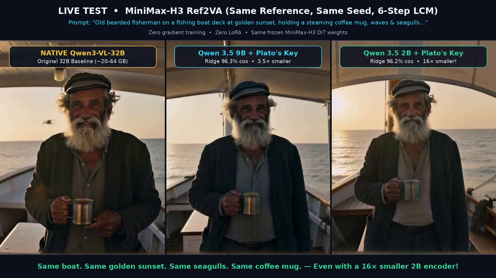
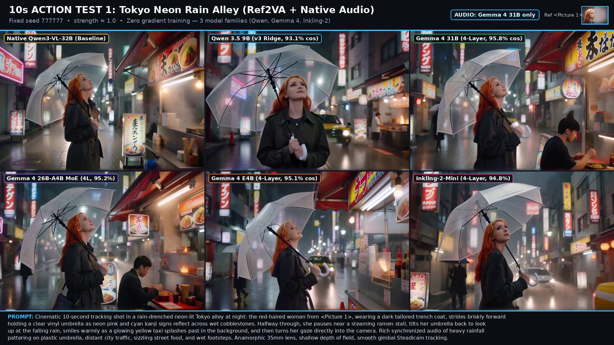

# ComfyUI-H3-Text-Encoders

> [!IMPORTANT]
> **NEW (`v5c` Word-Span Aligned + Layer-0 Multi-Layer Ridge) — ALL 6 cross-family keys upgraded (`Inkling-2-Mini: R² 0.927 / 96.23% cos`, `Gemma 4 31B: R² 0.923 / 95.97%`, `26B-A4B MoE: R² 0.913 / 95.43%`, `E4B: R² 0.901 / 94.86%`, `E2B: R² 0.894 / 94.46%`, `12B FIXED: R² 0.879 / 93.67%`)**, PLUS unified ComfyUI-native single-file **`Gemma 4 31B`** text encoders (`bf16`, `int8_convrot`, `w4a8`, `nvfp4`) and **`v3 Direct-32B Streaming Ridge`** for all **Qwen 3.5 & Qwen 3.8 27B** (`0.985–0.992 R²`)!
> - **Recommendation:** use **`*_pk_ridge_*.safetensors`** for Qwen 3.5 / 3.8 and **`*_pk_ridge_4layer_*.safetensors`** for Gemma 4 & Inkling-2-Mini (`strength = 1.0`, same filenames — drop-in replacement!).

> [!WARNING]
> **Upgrading from early releases (`< v0.1.8`)?** Please update your custom node (`cd ComfyUI/custom_nodes/ComfyUI-H3-Text-Encoders && git pull` or update via ComfyUI Manager) and restart ComfyUI! Recent updates (`v0.1.5–v0.1.8`) added **critical fixes** (`options_default` tuple parity, Gemma 4 `<bos>` sink handling, **Multi-Layer `donor_layers`**, and `text_encoders/` dropdown scanning in `PlatosKeyHFTextEncoderLoader`). If you downloaded earlier `v4` or single-layer cross-family keys, re-download the updated `v5c` **`*_pk_ridge_4layer_*.safetensors`** keys for a massive `R²` jump (`~0.61 → 0.88–0.93`) and the **`Gemma 4 12B`** fix!

> [!NOTE]
> **Spoken Dialogue / Speech Audio Note (Cross-Family Encoders):**
> - **For 100%-crisp spoken dialogue & lip-sync:** use **Qwen 3.5 (`9B` / `2B` / `4B` / `0.8B`)** or **Qwen 3.8 `27B`** — they share the exact BPE tokenizer with native `Qwen3-VL-32B` and are calibrated **1:1 per token**, preserving crystal-clear English speech.
> - **Cross-family encoders (`Gemma 4` / `Inkling-2-Mini`):** our new **`v5c`** keys use exact word-span alignment (`offset_mapping`), layer-0 lexical embeddings, and dialogue-enriched calibration — delivering **near pixel-identical visuals, Ref2VA identity, and ambient SFX** (`R² = 0.88–0.93`, `p10 = 87.5–92.5%`) and cleaner voice cadence than `v4`, though exact word-for-word spoken dialogue across different tokenizers is still best handled by same-tokenizer **Qwen 3.5 / 3.8**.

Use modern ComfyUI-native text encoders (**Qwen 3.5 0.8B / 2B / 4B / 9B**, **Qwen 3.8 27B**, **Google Gemma 4**) — or **any HuggingFace LLM/VLM** (like **Inkling-2-Mini** or **Gemma 4 26B-A4B**) — as a conditioning encoder for **MiniMax-H3** (**T2VA / Image-to-Video**, **FL2VA**, and **Ref2VA**) in ComfyUI — **zero gradient training, zero LoRA, and zero external MLP weights**.

Powered by **Plato's Key** (*closed-form Ridge & Multi-Layer Ridge*, inspired by Stanford Hazy Research's [Plato's Key](https://hazyresearch.stanford.edu/blog/2026-11-25-platos-key)), each adapter is a compact `.safetensors` key (~20–157 MB) that projects a donor encoder's hidden states directly into MiniMax-H3's native **5,120-dim `Qwen3-VL-32B`** geometric space:

$$\hat{Y} = (X - \mu_{\text{donor}}) W + \mu_{\text{target}}, \qquad W = (X_c^\top X_c + \lambda I)^{-1} X_c^\top Y_c$$

All downstream MiniMax-H3 nodes (`MiniMaxH3ReferenceToVideo`, `MiniMaxH3ImageToVideo`, `SamplerCustomAdvanced`, `VAEDecode`) work out of the box.

## Key Engineering Breakthroughs

1. **Closed-Form Ridge >> Orthogonal Procrustes on MiniMax-H3:** MiniMax-H3's native 5,120-dim `Qwen3-VL-32B` space (layer 50, unnormalized) has strong anisotropic outlier channels. Rigid isotropic Procrustes stops at `R² ≈ 0.04`, whereas closed-form Ridge scales each channel independently, reaching **`R² = 0.990–0.992`** (**147× lower MSE**) on Qwen 3.5 & Qwen 3.8.
2. **Word-Span Aligned Multi-Layer Plato's Key (`v5c` + Layer-0 Lexical Embedding):** Single-layer linear maps across different architectures/tokenizers (Google Gemma 4 / Inkling-2-Mini → Qwen3-VL-32B) hit a ceiling (~70% cos). Concatenating **5–6 transformer layers including `layer 0`** (e.g., `[0, -1, -2, -8, -16, -24]`) and aligning donor and target hidden states via **exact character-offset word spans (`offset_mapping`, >500k aligned words)** against exact ComfyUI `Qwen3-VL-32B` layer `49` (`hidden_states[50]`) jumps cross-family fidelity from `R² ≈ 0.61` to **`R² = 0.879–0.927`** (`Inkling-2-Mini: 96.23% cos / R² 0.927`, `Gemma 4 31B: 95.97% / R² 0.923`, `26B-A4B MoE: 95.43% / R² 0.913`, `E4B: 94.86% / R² 0.901`, `E2B: 94.46% / R² 0.894`, `12B FIXED: 93.67% / R² 0.879`) with **zero gradient training and zero extra forward passes** in ComfyUI!
3. **Token-0 Attention Sink Filtering (`v4` Clean 20k):** Unnormalized `Qwen3-VL-32B` layer 50 puts a massive attention sink on token 0 (`rms ≈ 18.25, max > 3,000` vs `rms ≈ 3.42` for normal text). Dropping bin 0 during cross-family bin-pooled calibration eliminates a 33× Frobenius blow-up in `W`, cutting MSE by **42×** (`59.2 → 1.40`) and lifting `Gemma 4 E4B` to **`95.14%` cosine (`p10 = 87.91%`)**!
4. **Exact ComfyUI CLIP Parity (`v0.1.5+`):** Automatically enforces `options_default` tuple override, layer & `RMSNorm` parity, `llama_template="{}"`, LTXV `min_length=1` padding strip, Gemma 4 `<bos>` attention-sink retention (stripping token 0 post-encode), and `minimax_token_tags`.
5. **Universal HuggingFace Loader (`v0.1.6`):** **`Plato's Key Load Any HF Text Encoder (H3)`** loads *any* `transformers` LLM/VLM (even models without a native ComfyUI `CLIPLoader`, like `thinkingmachines/Inkling-2-Mini`) with automatic single- or multi-layer projection and automatic CPU offload to keep 100% of VRAM free for the H3 DiT.

## Visual Comparison (Zero-Gradient Ridge, No LoRA, No MLP)

[](https://huggingface.co/Alissonerdx/TE-PK-Minimax-H3/resolve/main/showcase/H3_PlatosKey_X_Demo_Final.mp4)

- [Watch / download full explainer + comparison video (`showcase/H3_PlatosKey_X_Demo_Final.mp4`)](showcase/H3_PlatosKey_X_Demo_Final.mp4)

### 4-Way Ref2VA — Native 32B vs Qwen 3.5 9B/2B vs Google Gemma 4 E4B (4-Layer, `strength = 1.0`)


### Multi-Layer 4-Way Video Showcase (Gemma 4 Before/After + Parisian Café Ref2VA + Swiss Alps Train T2VA)

[](https://huggingface.co/Alissonerdx/TE-PK-Minimax-H3/resolve/main/showcase/H3_PlatosKey_MultiLayer_4Way_Showcase.mp4)

- [Watch / download the 3-segment 4-way comparison video (`showcase/H3_PlatosKey_MultiLayer_4Way_Showcase.mp4`)](showcase/H3_PlatosKey_MultiLayer_4Way_Showcase.mp4) — featuring **Gemma 4 E4B 1-Layer vs 4-Layer Clean**, **Parisian Café Ref2VA (`Native 32B` | `Qwen 3.5 9B` | `Gemma 4 E4B 4L` | `Gemma 4 E2B 4L`)**, and **Swiss Alps Steam Train Pure T2VA (`Native 32B` | `Qwen 3.5 9B` | `Qwen 3.5 2B` | `Gemma 4 E4B 4L`)** at `strength = 1.0`.

### 10-Second 6-Way Action Stress Test (3 Model Families: Qwen + Google Gemma 4 + Inkling-2-Mini)

[](https://huggingface.co/Alissonerdx/TE-PK-Minimax-H3/resolve/main/showcase/H3_PlatosKey_10s_6Way_Action_Showcase.mp4)

- [Watch / download the 20s 6-way action showcase (`showcase/H3_PlatosKey_10s_6Way_Action_Showcase.mp4`)](showcase/H3_PlatosKey_10s_6Way_Action_Showcase.mp4) — **fixed seed, `strength = 1.0`, full prompts on screen**, comparing **`Native 32B`** | **`Qwen 3.5 9B`** | **`Gemma 4 31B`** | **`Gemma 4 26B-A4B MoE`** | **`Gemma 4 E4B`** | **`Inkling-2-Mini`** across **10s Tokyo Neon Rain (Ref2VA)** and **10s Medieval Blacksmith Forge (Pure T2VA)**.

## Pre-Calibrated Weights & Direct Download Links

All `.safetensors` Plato's Key adapters live in [**`Alissonerdx/TE-PK-Minimax-H3`**](https://huggingface.co/Alissonerdx/TE-PK-Minimax-H3) (calibrated on 20,029 prompts directly to Native `Qwen3-VL-32B` Layer 50).

### Text Encoder Downloads & Matching Plato's Keys

| Encoder | ComfyUI Loader | Text Encoder Download (HuggingFace) | Method | **Val Metrics (`Cos` / `R²`)** | **Key File (`Alissonerdx/TE-PK-Minimax-H3`)** |
|---|---|---|:---:|---:|---|
| **Qwen 3.5 9B** ⭐ | `CLIPLoader` + `PlatosKeyPatchCLIP` | [**`Comfy-Org/Qwen3.5`**](https://huggingface.co/Comfy-Org/Qwen3.5/tree/main/text_encoders) (`qwen3.5_9b_int8_convrot.safetensors` `9.8 GB` / `bf16` `19.3 GB`) | Ridge (`-1`) | **93.05%** (`R² 0.9905`) | [`minimax_h3_32b_pk_ridge_qwen3.5_9b.safetensors`](https://huggingface.co/Alissonerdx/TE-PK-Minimax-H3/resolve/main/qwen3.5/minimax_h3_32b_pk_ridge_qwen3.5_9b.safetensors) |
| **Qwen 3.5 2B** | `CLIPLoader` + `PlatosKeyPatchCLIP` | [**`Comfy-Org/Qwen3.5`**](https://huggingface.co/Comfy-Org/Qwen3.5/tree/main/text_encoders) (`qwen3.5_2b_bf16.safetensors` `4.6 GB`) | Ridge (`-1`) | **92.57%** (`R² 0.9916`) | [`minimax_h3_32b_pk_ridge_qwen3.5_2b.safetensors`](https://huggingface.co/Alissonerdx/TE-PK-Minimax-H3/resolve/main/qwen3.5/minimax_h3_32b_pk_ridge_qwen3.5_2b.safetensors) |
| **Qwen 3.5 4B** | `CLIPLoader` + `PlatosKeyPatchCLIP` | [**`Comfy-Org/Qwen3.5`**](https://huggingface.co/Comfy-Org/Qwen3.5/tree/main/text_encoders) (`qwen3.5_4b_bf16.safetensors` `9.3 GB`) | Ridge (`-1`) | **91.82%** (`R² 0.9902`) | [`minimax_h3_32b_pk_ridge_qwen3.5_4b.safetensors`](https://huggingface.co/Alissonerdx/TE-PK-Minimax-H3/resolve/main/qwen3.5/minimax_h3_32b_pk_ridge_qwen3.5_4b.safetensors) |
| **Qwen 3.5 0.8B** | `PlatosKeyHFTextEncoderLoader` | [**`Qwen/Qwen3.5-0.8B`**](https://huggingface.co/Qwen/Qwen3.5-0.8B) | Ridge (`-1`) | **91.11%** (`R² 0.9901`) | [`minimax_h3_32b_pk_ridge_qwen3.5_0.8b.safetensors`](https://huggingface.co/Alissonerdx/TE-PK-Minimax-H3/resolve/main/qwen3.5/minimax_h3_32b_pk_ridge_qwen3.5_0.8b.safetensors) |
| **Qwen 3.8 27B** | `CLIPLoader` + `PlatosKeyPatchCLIP` | [**`Comfy-Org/Qwen3.8-27B`**](https://huggingface.co/Comfy-Org/Qwen3.8-27B/tree/main/text_encoders) (`qwen3.8_27b_w4a8.safetensors` `17.3 GB`) | Ridge (`-1`) | **89.94%** (`R² 0.9846`) | [`minimax_h3_32b_pk_ridge_qwen3.8_27b.safetensors`](https://huggingface.co/Alissonerdx/TE-PK-Minimax-H3/resolve/main/qwen3.8/minimax_h3_32b_pk_ridge_qwen3.8_27b.safetensors) |
| **Inkling-2-Mini** 🏆⭐ | `PlatosKeyHFTextEncoderLoader` | [**`thinkingmachines/Inkling-2-Mini`**](https://huggingface.co/thinkingmachines/Inkling-2-Mini) | **6L v5c** | **96.23%** (`R² 0.9272`, `p10 92.5%`) | [`minimax_h3_32b_pk_ridge_4layer_inkling2_mini.safetensors`](https://huggingface.co/Alissonerdx/TE-PK-Minimax-H3/resolve/main/inkling2/minimax_h3_32b_pk_ridge_4layer_inkling2_mini.safetensors) |
| **Gemma 4 31B** 🏆 | `CLIPLoader` + `PlatosKeyPatchCLIP` | [**`Alissonerdx/TE-PK-Minimax-H3/text_encoders`**](https://huggingface.co/Alissonerdx/TE-PK-Minimax-H3/tree/main/text_encoders) ([`nvfp4` `19.1 GB`](https://huggingface.co/Alissonerdx/TE-PK-Minimax-H3/resolve/main/text_encoders/gemma4_31b_it_nvfp4.safetensors) / [`w4a8` `19.1 GB`](https://huggingface.co/Alissonerdx/TE-PK-Minimax-H3/resolve/main/text_encoders/gemma4_31b_it_w4a8.safetensors) / [`int8_convrot` `31.9 GB`](https://huggingface.co/Alissonerdx/TE-PK-Minimax-H3/resolve/main/text_encoders/gemma4_31b_it_int8_convrot.safetensors) / [`bf16` `62.6 GB`](https://huggingface.co/Alissonerdx/TE-PK-Minimax-H3/resolve/main/text_encoders/gemma4_31b_it_bf16.safetensors)) | **5L v5c** | **95.97%** (`R² 0.9229`, `p10 92.0%`) | [`minimax_h3_32b_pk_ridge_4layer_gemma4_31b.safetensors`](https://huggingface.co/Alissonerdx/TE-PK-Minimax-H3/resolve/main/gemma4/minimax_h3_32b_pk_ridge_4layer_gemma4_31b.safetensors) |
| **Gemma 4 26B-A4B (MoE)** ⭐ | `PlatosKeyHFTextEncoderLoader` | [**`google/gemma-4-26B-A4B-it`**](https://huggingface.co/google/gemma-4-26B-A4B-it) | **6L v5c** | **95.43%** (`R² 0.9128`, `p10 90.9%`) | [`minimax_h3_32b_pk_ridge_4layer_gemma4_26b_a4b.safetensors`](https://huggingface.co/Alissonerdx/TE-PK-Minimax-H3/resolve/main/gemma4/minimax_h3_32b_pk_ridge_4layer_gemma4_26b_a4b.safetensors) |
| **Gemma 4 E4B** ⭐ | `CLIPLoader` + `PlatosKeyPatchCLIP` | [**`Comfy-Org/gemma-4`**](https://huggingface.co/Comfy-Org/gemma-4/tree/main/text_encoders) (`gemma4_e4b_it_int8_convrot.safetensors` `8.1 GB` / `fp8` `9.1 GB` / `bf16` `16.0 GB`) | **6L v5c** | **94.86%** (`R² 0.9012`, `p10 90.0%`) | [`minimax_h3_32b_pk_ridge_4layer_gemma4_e4b.safetensors`](https://huggingface.co/Alissonerdx/TE-PK-Minimax-H3/resolve/main/gemma4/minimax_h3_32b_pk_ridge_4layer_gemma4_e4b.safetensors) |
| **Gemma 4 E2B** ⭐ | `CLIPLoader` + `PlatosKeyPatchCLIP` | [**`Comfy-Org/gemma-4`**](https://huggingface.co/Comfy-Org/gemma-4/tree/main/text_encoders) (`gemma4_e2b_it_int8_convrot.safetensors` `5.2 GB` / `bf16` `10.3 GB`) | **6L v5c** | **94.46%** (`R² 0.8936`, `p10 89.4%`) | [`minimax_h3_32b_pk_ridge_4layer_gemma4_e2b.safetensors`](https://huggingface.co/Alissonerdx/TE-PK-Minimax-H3/resolve/main/gemma4/minimax_h3_32b_pk_ridge_4layer_gemma4_e2b.safetensors) |
| **Gemma 4 12B** | `CLIPLoader` + `PlatosKeyPatchCLIP` | [**`Comfy-Org/gemma-4`**](https://huggingface.co/Comfy-Org/gemma-4/tree/main/text_encoders) (`gemma4_12b_int8_convrot.safetensors` `12.1 GB`) | **5L v5c** | **93.67%** (`R² 0.8790`, `p10 87.5%`) | [`minimax_h3_32b_pk_ridge_4layer_gemma4_12b.safetensors`](https://huggingface.co/Alissonerdx/TE-PK-Minimax-H3/resolve/main/gemma4/minimax_h3_32b_pk_ridge_4layer_gemma4_12b.safetensors) |

> [!TIP]
> **Plug & Play recommendation:** For native ComfyUI `CLIPLoader` (single `.safetensors` in `ComfyUI/models/text_encoders/`), start with **`Qwen 3.5 9B`** (best all-around + crystal-clear spoken dialogue), **`Gemma 4 E4B`** (`8.1 GB int8` / `9.1 GB fp8`, `R² 0.901`), **`Gemma 4 E2B`** (`5.2 GB int8`, `R² 0.894`), or our unified **`Gemma 4 31B`** (`19.1 GB nvfp4/w4a8`, `R² 0.923`). For HuggingFace repos (`thinkingmachines/Inkling-2-Mini` — **#1 cross-family `R² 0.927`!** — or `google/gemma-4-26B-A4B-it`), use **`Plato's Key Load Any HF Text Encoder (H3)`** directly.

## Step-by-Step Setup (Where to Place Files)

1. **Install this custom node**:
```bash
cd ComfyUI/custom_nodes
git clone https://github.com/alisson-anjos/ComfyUI-H3-Text-Encoders.git
cd ComfyUI-H3-Text-Encoders
pip install -r requirements.txt
```

2. **Download a Text Encoder** from the table above and place single-file `.safetensors` models in **`ComfyUI/models/text_encoders/`** (or skip manual downloads for any HuggingFace repo by using **`Plato's Key Load Any HF Text Encoder (H3)`**).

3. **Download the matching `.safetensors` key** from [**`Alissonerdx/TE-PK-Minimax-H3`**](https://huggingface.co/Alissonerdx/TE-PK-Minimax-H3) and place it in **`ComfyUI/models/clip_projections/`**:
```text
ComfyUI/models/
├── text_encoders/
│   ├── qwen3.5_9b_int8_convrot.safetensors
│   └── gemma4_e4b_it_fp8_scaled.safetensors
└── clip_projections/
    ├── minimax_h3_32b_pk_ridge_qwen3.5_9b.safetensors
    └── minimax_h3_32b_pk_ridge_4layer_gemma4_e4b.safetensors
```

4. **Restart ComfyUI** and wire:
   - **Native ComfyUI encoders:** `Load CLIP` → **`Plato's Key Patch CLIP (H3 Plug & Play)`** (`strength = 1.00`, `apply_to_pooled = False`) → `MiniMax H3 Reference to Video` / `MiniMax H3 Image to Video`.
   - **Any HuggingFace model:** **`Plato's Key Load Any HF Text Encoder (H3)`** (`model_id`, `key_file`, `offload_to_cpu = True`) → `MiniMax H3 Reference to Video` / `MiniMax H3 Image to Video`.

### Included ComfyUI Nodes (`conditioning/platos_key`)

- **`Plato's Key Patch CLIP (H3 Plug & Play)`**: Drop-in wrapper for native ComfyUI `CLIPLoader` (auto layer, multi-layer `donor_layers`, `RMSNorm`, `<bos>`, and `minimax_token_tags` parity).
- **`Plato's Key Load Any HF Text Encoder (H3)`**: Loads any `transformers` model from HuggingFace or disk, applies single- or multi-layer Plato's Key, and auto-offloads to CPU after encoding.
- **`Plato's Key Apply (Procrustes)`**: Projects an existing `CONDITIONING` tensor directly.
- **`Plato's Key CLIP Text Encode`**: One-step text encode + Plato's Key projection.

## Calibration & Conversion Script (Create Your Own Key — Zero Gradients)

Convert any HuggingFace text encoder in minutes with [`calibrate_platos_key.py`](calibrate_platos_key.py) (`--method ridge` by default, with automatic held-out `λ` selection):

```bash
python calibrate_platos_key.py \
  --donor Qwen/Qwen3.5-2B \
  --target Qwen/Qwen3.5-9B \
  --method ridge \
  --align token \
  --output keys/my_ridge_key.safetensors
```

### Python API (`platos_key_core.py`)

```python
from platos_key_core import fit_ridge_key, evaluate_platos_key, save_platos_key

key = fit_ridge_key(x_donor_train, x_target_train, ridge_lambda=100.0)
metrics = evaluate_platos_key(x_donor_val, x_target_val, key)
save_platos_key(key, "ComfyUI/models/clip_projections/my_custom_key.safetensors")
```

## License

Apache 2.0 — see [LICENSE](LICENSE). Inspired by Stanford Hazy Research's [Plato's Key](https://hazyresearch.stanford.edu/blog/2026-11-25-platos-key).
