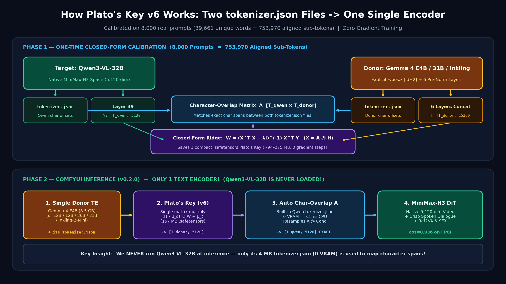
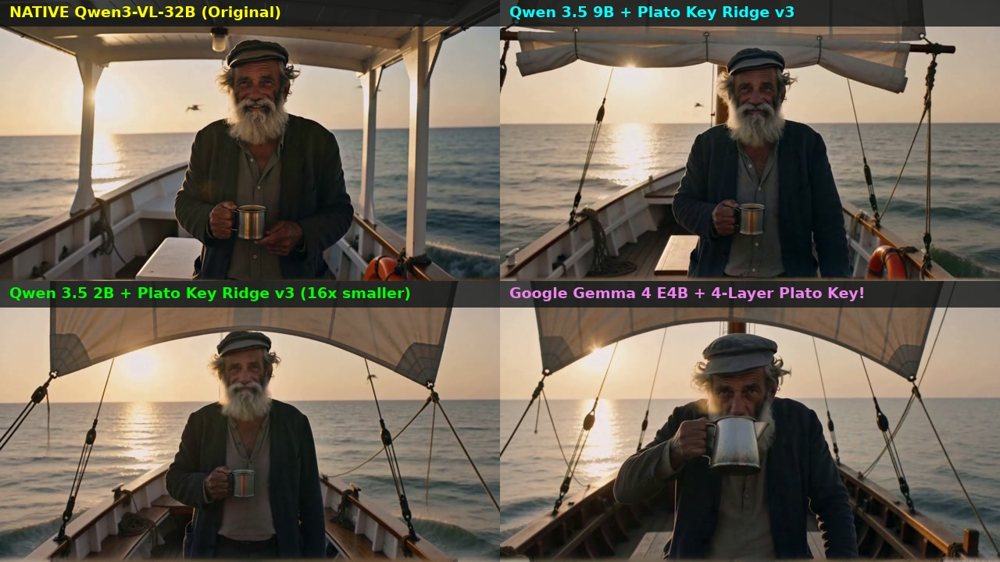
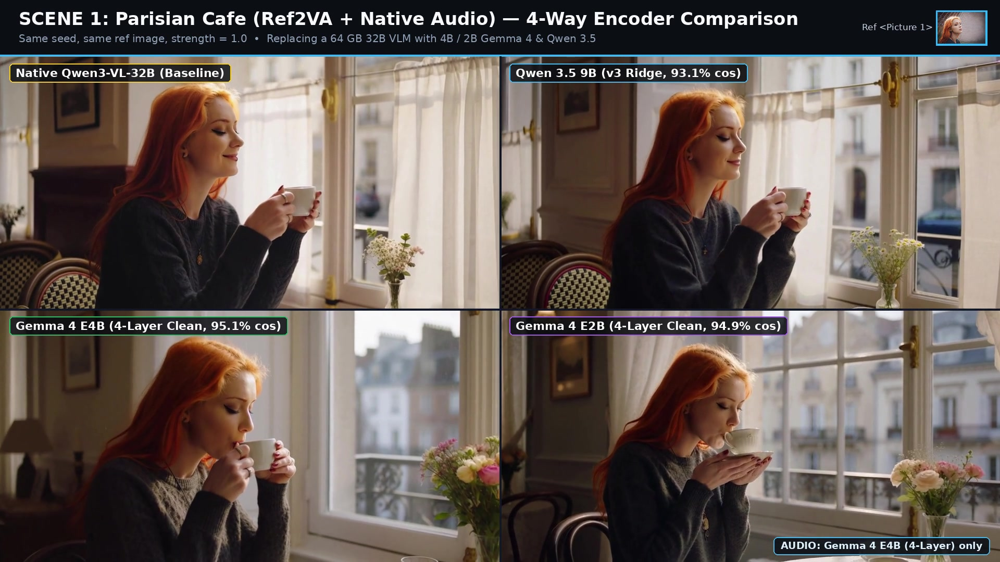

# ComfyUI-H3-Text-Encoders

> [!IMPORTANT]
> **NEW (`v0.2.0` + `charov` Exact Token-Level Alignment) — ALL 6 cross-family keys now have `*_pk_ridge_charov_*.safetensors` variants!**
> - **What is `charov`?** Short for **Character-Overlap (`A @ H`)** — instead of pooling whole words (`4layer`), `charov` builds a deterministic subword overlap matrix `A` (`0 VRAM`, `<1ms` CPU) that maps donor subwords directly onto exact native `Qwen3-VL-32B` token positions (with exact `<bos>` parity and ComfyUI `fp8`/`int8`-robust Ridge calibration). See [`CHAR_OVERLAP_V6.md`](CHAR_OVERLAP_V6.md) for the full technical writeup.
> - **Recommendation:**
>   - **Qwen 3.5 / Qwen 3.8:** use **`*_pk_ridge_*.safetensors`** (`R² 0.985–0.992`, 1:1 shared BPE tokenizer).
>   - **Gemma 4 / Inkling-2-Mini:** choose **`*_pk_ridge_charov_*.safetensors`** (requires node **`v0.2.0+`**, big upgrade on spoken dialogue & multi-shot scenes) or keep **`*_pk_ridge_4layer_*.safetensors`** (word-span pooled, works on `v0.1.8+`, both stay live side-by-side at `strength = 1.0`).

> [!WARNING]
> **Using `charov` keys requires `v0.2.0+`!** Update your custom node (`cd ComfyUI/custom_nodes/ComfyUI-H3-Text-Encoders && git pull` or update via ComfyUI Manager) and restart ComfyUI. `v0.2.0` automatically detects `alignment="char_overlap_qwen"` in `.safetensors` metadata and applies exact `A @ H` resampling offline using ComfyUI's built-in Qwen tokenizer (`0 VRAM`, 100% backward-compatible with all `4layer` and Qwen keys).

> [!NOTE]
> **Honest Note on Spoken Dialogue & Multi-Shot Scenes (Cross-Family Encoders):**
> - **For 100%-crisp spoken dialogue, lip-sync & complex multi-shot choreography:** **Qwen 3.5 (`9B` / `2B` / `4B` / `0.8B`)** and **Qwen 3.8 `27B`** remain **#1**, because they share the exact BPE tokenizer 1:1 with native `Qwen3-VL-32B`.
> - **Cross-family `charov` keys (`Gemma 4` / `Inkling-2-Mini`):** deliver a **major leap over `4layer`** on spoken dialogue intelligibility and multi-shot scene transitions (for example, `Gemma 4 E4B` jumped from `79.7%` to **`93.6%` live token-by-token cosine** in ComfyUI `fp8_scaled`, turning garbled audio into clear English sentences). However, a purely linear cross-tokenizer projection still does not 100% match native 32B on every complex multi-shot or fast-dialogue prompt — a lightweight, single-encoder residual refiner is in active R&D to close the remaining gap.

Use modern ComfyUI-native text encoders (**Qwen 3.5 0.8B / 2B / 4B / 9B**, **Qwen 3.8 27B**, **Google Gemma 4**) — or **any HuggingFace LLM/VLM** (like **Inkling-2-Mini** or **Gemma 4 26B-A4B**) — as a conditioning encoder for **MiniMax-H3** (**T2VA / Image-to-Video**, **FL2VA**, and **Ref2VA**) in ComfyUI — **zero gradient training, zero LoRA, and zero external MLP weights**.

Powered by **Plato's Key** (*closed-form Ridge & Multi-Layer Ridge*, inspired by Stanford Hazy Research's [Plato's Key](https://hazyresearch.stanford.edu/blog/2026-11-25-platos-key)), each adapter is a compact `.safetensors` key (~20–275 MB) that projects a donor encoder's hidden states directly into MiniMax-H3's native **5,120-dim `Qwen3-VL-32B`** geometric space:

$$\hat{Y} = (X - \mu_{\text{donor}}) W + \mu_{\text{target}}, \qquad W = (X_c^\top X_c + \lambda I)^{-1} X_c^\top Y_c$$

All downstream MiniMax-H3 nodes (`MiniMaxH3ReferenceToVideo`, `MiniMaxH3ImageToVideo`, `SamplerCustomAdvanced`, `VAEDecode`) work out of the box.

## How `charov` (Character-Overlap `A @ H`) Works

Cross-family models tokenize the same prompt into completely different subword sequences (for example, Gemma 4 SentencePiece vs Qwen3 BPE). `4layer` keys align models at the **whole-word** level, which is great for visuals/SFX but blurs token-level timing needed for speech and multi-shot transitions.

**`charov` keys** solve this with an exact, deterministic **character-overlap resampling matrix** $A \in \mathbb{R}^{T_{\text{qwen}} \times T_{\text{donor}}}$ (row-stochastic, $A \mathbf{1} = \mathbf{1}$). Because $A$ is linear and row-stochastic, it **commutes exactly** with the closed-form Ridge projection:

$$A \cdot \big((H - \mu_{\text{donor}}) W + \mu_{\text{target}}\big) \equiv (A H - \mu_{\text{donor}}) W + \mu_{\text{target}}$$

In ComfyUI `v0.2.0+`, the node automatically runs this resampling in `<1ms` on CPU (`0 VRAM`), giving every Qwen token slot the exact subword-aligned representation expected by the MiniMax-H3 DiT.




## Key Engineering Breakthroughs

1. **Closed-Form Ridge >> Orthogonal Procrustes on MiniMax-H3:** MiniMax-H3's native 5,120-dim `Qwen3-VL-32B` space (layer 50, unnormalized) has strong anisotropic outlier channels. Rigid isotropic Procrustes stops at `R² ≈ 0.04`, whereas closed-form Ridge scales each channel independently, reaching **`R² = 0.990–0.992`** (**147× lower MSE**) on Qwen 3.5 & Qwen 3.8.
2. **Exact Token-Level `charov` (`A @ H`) + BOS Parity (`v0.2.0`):** Calibrating directly on exact individual Qwen3-VL-32B layer 49 tokens via character-overlap matrix `A @ H` — with explicit `<bos>` parity, ComfyUI-matched intermediate layers (replacing divergent `final_norm`), and quantization-robust FP64 Ridge solving — lifts live ComfyUI `fp8_scaled` token-by-token cosine on `Gemma 4 E4B` from `79.7%` to **`93.6%` (`p10 = 90.4%`)** with **zero gradient training**. *(Note: `charov` `R²` is measured on exact individual subword tokens, which is a much stricter metric than word-averaged `4layer` `R²`.)*
3. **Word-Span Aligned Multi-Layer Plato's Key (`4layer`):** Concatenating 5–6 transformer layers including `layer 0` (`offset_mapping` word-span alignment) remains available alongside `charov` for users on `v0.1.8+` or comparing styles.
4. **Token-0 Attention Sink Filtering & Exact ComfyUI CLIP Parity:** Automatically enforces `options_default` tuple override, layer & `RMSNorm` parity, `llama_template="{}"`, LTXV `min_length=1` padding strip, Gemma 4 `<bos>` attention-sink retention, and `minimax_token_tags`.
5. **Universal HuggingFace Loader:** **`Plato's Key Load Any HF Text Encoder (H3)`** loads *any* `transformers` LLM/VLM (even models without a native ComfyUI `CLIPLoader`, like `thinkingmachines/Inkling-2-Mini`) with automatic single-layer, multi-layer, and `charov` support plus CPU offload.

## Visual Comparison (Zero-Gradient Ridge, No LoRA, No MLP)

[](https://huggingface.co/Alissonerdx/TE-PK-Minimax-H3/resolve/main/showcase/H3_PlatosKey_X_Demo_Final.mp4)

- [Watch / download full explainer + comparison video (`showcase/H3_PlatosKey_X_Demo_Final.mp4`)](showcase/H3_PlatosKey_X_Demo_Final.mp4)

### 4-Way Ref2VA — Native 32B vs Qwen 3.5 9B/2B vs Google Gemma 4 E4B (4-Layer, `strength = 1.0`)



### Multi-Layer 4-Way Video Showcase (Gemma 4 Before/After + Parisian Café Ref2VA + Swiss Alps Train T2VA)

[](https://huggingface.co/Alissonerdx/TE-PK-Minimax-H3/resolve/main/showcase/H3_PlatosKey_MultiLayer_4Way_Showcase.mp4)

- [Watch / download the 3-segment 4-way comparison video (`showcase/H3_PlatosKey_MultiLayer_4Way_Showcase.mp4`)](showcase/H3_PlatosKey_MultiLayer_4Way_Showcase.mp4) — featuring **Gemma 4 E4B 1-Layer vs 4-Layer Clean**, **Parisian Café Ref2VA (`Native 32B` | `Qwen 3.5 9B` | `Gemma 4 E4B 4L` | `Gemma 4 E2B 4L`)**, and **Swiss Alps Steam Train Pure T2VA (`Native 32B` | `Qwen 3.5 9B` | `Qwen 3.5 2B` | `Gemma 4 E4B 4L`)** at `strength = 1.0`.

### 10-Second 6-Way Action Stress Test (3 Model Families: Qwen + Google Gemma 4 + Inkling-2-Mini)

[](https://huggingface.co/Alissonerdx/TE-PK-Minimax-H3/resolve/main/showcase/H3_PlatosKey_10s_6Way_Action_Showcase.mp4)

- [Watch / download the 20s 6-way action showcase (`showcase/H3_PlatosKey_10s_6Way_Action_Showcase.mp4`)](showcase/H3_PlatosKey_10s_6Way_Action_Showcase.mp4) — **fixed seed, `strength = 1.0`, full prompts on screen**, comparing **`Native 32B`** | **`Qwen 3.5 9B`** | **`Gemma 4 31B`** | **`Gemma 4 26B-A4B MoE`** | **`Gemma 4 E4B`** | **`Inkling-2-Mini`** across **10s Tokyo Neon Rain (Ref2VA)** and **10s Medieval Blacksmith Forge (Pure T2VA)**.

## Pre-Calibrated Weights & Direct Download Links

All `.safetensors` Plato's Key adapters live in [**`Alissonerdx/TE-PK-Minimax-H3`**](https://huggingface.co/Alissonerdx/TE-PK-Minimax-H3).

### Same-Tokenizer Encoders (Qwen 3.5 / Qwen 3.8 — 1:1 Token Ridge)

| Encoder | ComfyUI Loader | Text Encoder Download (HuggingFace) | **Val Metrics (`Cos` / `R²`)** | **Key File (`Alissonerdx/TE-PK-Minimax-H3`)** |
|---|---|---|---:|---|
| **Qwen 3.5 9B** ⭐ | `CLIPLoader` + `PlatosKeyPatchCLIP` | [**`Comfy-Org/Qwen3.5`**](https://huggingface.co/Comfy-Org/Qwen3.5/tree/main/text_encoders) (`qwen3.5_9b_int8_convrot.safetensors` `9.8 GB` / `bf16` `19.3 GB`) | **93.05%** (`R² 0.9905`) | [`minimax_h3_32b_pk_ridge_qwen3.5_9b.safetensors`](https://huggingface.co/Alissonerdx/TE-PK-Minimax-H3/resolve/main/qwen3.5/minimax_h3_32b_pk_ridge_qwen3.5_9b.safetensors) |
| **Qwen 3.5 2B** | `CLIPLoader` + `PlatosKeyPatchCLIP` | [**`Comfy-Org/Qwen3.5`**](https://huggingface.co/Comfy-Org/Qwen3.5/tree/main/text_encoders) (`qwen3.5_2b_bf16.safetensors` `4.6 GB`) | **92.57%** (`R² 0.9916`) | [`minimax_h3_32b_pk_ridge_qwen3.5_2b.safetensors`](https://huggingface.co/Alissonerdx/TE-PK-Minimax-H3/resolve/main/qwen3.5/minimax_h3_32b_pk_ridge_qwen3.5_2b.safetensors) |
| **Qwen 3.5 4B** | `CLIPLoader` + `PlatosKeyPatchCLIP` | [**`Comfy-Org/Qwen3.5`**](https://huggingface.co/Comfy-Org/Qwen3.5/tree/main/text_encoders) (`qwen3.5_4b_bf16.safetensors` `9.3 GB`) | **91.82%** (`R² 0.9902`) | [`minimax_h3_32b_pk_ridge_qwen3.5_4b.safetensors`](https://huggingface.co/Alissonerdx/TE-PK-Minimax-H3/resolve/main/qwen3.5/minimax_h3_32b_pk_ridge_qwen3.5_4b.safetensors) |
| **Qwen 3.5 0.8B** | `PlatosKeyHFTextEncoderLoader` | [**`Qwen/Qwen3.5-0.8B`**](https://huggingface.co/Qwen/Qwen3.5-0.8B) | **91.11%** (`R² 0.9901`) | [`minimax_h3_32b_pk_ridge_qwen3.5_0.8b.safetensors`](https://huggingface.co/Alissonerdx/TE-PK-Minimax-H3/resolve/main/qwen3.5/minimax_h3_32b_pk_ridge_qwen3.5_0.8b.safetensors) |
| **Qwen 3.8 27B** | `CLIPLoader` + `PlatosKeyPatchCLIP` | [**`Comfy-Org/Qwen3.8-27B`**](https://huggingface.co/Comfy-Org/Qwen3.8-27B/tree/main/text_encoders) (`qwen3.8_27b_w4a8.safetensors` `17.3 GB`) | **89.94%** (`R² 0.9846`) | [`minimax_h3_32b_pk_ridge_qwen3.8_27b.safetensors`](https://huggingface.co/Alissonerdx/TE-PK-Minimax-H3/resolve/main/qwen3.8/minimax_h3_32b_pk_ridge_qwen3.8_27b.safetensors) |

### Cross-Family Encoders (`charov` Exact Token-Level vs `4layer` Word-Span)

> **Which file should I download?**
> - **`*_pk_ridge_charov_*.safetensors`** *(Recommended, requires node `v0.2.0+`)*: Exact token-level **Character-Overlap (`A @ H`)** alignment. Much better token timing for spoken dialogue and multi-shot prompts.
> - **`*_pk_ridge_4layer_*.safetensors`** *(Legacy/Word-Span, works on `v0.1.8+`)*: Word-span pooled alignment. Preserved side-by-side if you prefer its look or haven't updated yet.

| Encoder | ComfyUI Loader | Text Encoder Download (HuggingFace) | **`charov` Key (`v0.2.0+`, Exact Token `Cos` / `R²`)** | **`4layer` Key (Word-Span `Cos` / `R²`)** |
|---|---|---|---|---|
| **Gemma 4 31B** 🏆 | `CLIPLoader` + `PlatosKeyPatchCLIP` | [**`Alissonerdx/TE-PK-Minimax-H3/text_encoders`**](https://huggingface.co/Alissonerdx/TE-PK-Minimax-H3/tree/main/text_encoders) (`nvfp4` / `w4a8` `19.1 GB`, `int8` `31.9 GB`, `bf16` `62.6 GB`) | [`charov_gemma4_31b`](https://huggingface.co/Alissonerdx/TE-PK-Minimax-H3/resolve/main/gemma4/minimax_h3_32b_pk_ridge_charov_gemma4_31b.safetensors) (**95.90%** / `R² 0.831`, `p10 90.8%`) | [`4layer_gemma4_31b`](https://huggingface.co/Alissonerdx/TE-PK-Minimax-H3/resolve/main/gemma4/minimax_h3_32b_pk_ridge_4layer_gemma4_31b.safetensors) (`95.97%` / `R² 0.923`) |
| **Gemma 4 E4B** ⭐ | `CLIPLoader` + `PlatosKeyPatchCLIP` | [**`Comfy-Org/gemma-4`**](https://huggingface.co/Comfy-Org/gemma-4/tree/main/text_encoders) (`int8` `8.1 GB` / `fp8` `9.1 GB` / `bf16` `16.0 GB`) | [`charov_gemma4_e4b`](https://huggingface.co/Alissonerdx/TE-PK-Minimax-H3/resolve/main/gemma4/minimax_h3_32b_pk_ridge_charov_gemma4_e4b.safetensors) (**95.59%** / `R² 0.816`, `p10 90.3%`) | [`4layer_gemma4_e4b`](https://huggingface.co/Alissonerdx/TE-PK-Minimax-H3/resolve/main/gemma4/minimax_h3_32b_pk_ridge_4layer_gemma4_e4b.safetensors) (`94.86%` / `R² 0.901`) |
| **Gemma 4 26B-A4B (MoE)** ⭐ | `PlatosKeyHFTextEncoderLoader` | [**`google/gemma-4-26B-A4B-it`**](https://huggingface.co/google/gemma-4-26B-A4B-it) | [`charov_gemma4_26b_a4b`](https://huggingface.co/Alissonerdx/TE-PK-Minimax-H3/resolve/main/gemma4/minimax_h3_32b_pk_ridge_charov_gemma4_26b_a4b.safetensors) (**95.32%** / `R² 0.808`, `p10 89.3%`) | [`4layer_gemma4_26b_a4b`](https://huggingface.co/Alissonerdx/TE-PK-Minimax-H3/resolve/main/gemma4/minimax_h3_32b_pk_ridge_4layer_gemma4_26b_a4b.safetensors) (`95.43%` / `R² 0.913`) |
| **Gemma 4 12B** | `CLIPLoader` + `PlatosKeyPatchCLIP` | [**`Comfy-Org/gemma-4`**](https://huggingface.co/Comfy-Org/gemma-4/tree/main/text_encoders) (`gemma4_12b_int8_convrot.safetensors` `12.1 GB`) | [`charov_gemma4_12b`](https://huggingface.co/Alissonerdx/TE-PK-Minimax-H3/resolve/main/gemma4/minimax_h3_32b_pk_ridge_charov_gemma4_12b.safetensors) (**95.26%** / `R² 0.805`, `p10 89.1%`) | [`4layer_gemma4_12b`](https://huggingface.co/Alissonerdx/TE-PK-Minimax-H3/resolve/main/gemma4/minimax_h3_32b_pk_ridge_4layer_gemma4_12b.safetensors) (`93.67%` / `R² 0.879`) |
| **Gemma 4 E2B** ⭐ | `CLIPLoader` + `PlatosKeyPatchCLIP` | [**`Comfy-Org/gemma-4`**](https://huggingface.co/Comfy-Org/gemma-4/tree/main/text_encoders) (`int8` `5.2 GB` / `bf16` `10.3 GB`) | [`charov_gemma4_e2b`](https://huggingface.co/Alissonerdx/TE-PK-Minimax-H3/resolve/main/gemma4/minimax_h3_32b_pk_ridge_charov_gemma4_e2b.safetensors) (**94.77%** / `R² 0.781`, `p10 88.5%`) | [`4layer_gemma4_e2b`](https://huggingface.co/Alissonerdx/TE-PK-Minimax-H3/resolve/main/gemma4/minimax_h3_32b_pk_ridge_4layer_gemma4_e2b.safetensors) (`94.46%` / `R² 0.894`) |
| **Inkling-2-Mini** | `PlatosKeyHFTextEncoderLoader` | [**`thinkingmachines/Inkling-2-Mini`**](https://huggingface.co/thinkingmachines/Inkling-2-Mini) | [`charov_inkling2_mini`](https://huggingface.co/Alissonerdx/TE-PK-Minimax-H3/resolve/main/inkling2/minimax_h3_32b_pk_ridge_charov_inkling2_mini.safetensors) (**93.52%** / `R² 0.731`, `p10 84.7%`) | [`4layer_inkling2_mini`](https://huggingface.co/Alissonerdx/TE-PK-Minimax-H3/resolve/main/inkling2/minimax_h3_32b_pk_ridge_4layer_inkling2_mini.safetensors) (`96.23%` / `R² 0.927`) |

> [!TIP]
> **Plug & Play recommendation:** Start with **`Qwen 3.5 9B`** (best all-around + #1 for exact spoken dialogue & multi-shot), or try **`Gemma 4 E4B charov`** (`8.1 GB int8` / `9.1 GB fp8`) or **`Gemma 4 31B charov`** (`19.1 GB nvfp4/w4a8`) for strong cross-family visuals & improved speech!

## Step-by-Step Setup (Where to Place Files)

1. **Install or update this custom node (`v0.2.0+` required for `charov`)**:
```bash
cd ComfyUI/custom_nodes
git clone https://github.com/alisson-anjos/ComfyUI-H3-Text-Encoders.git
cd ComfyUI-H3-Text-Encoders
pip install -r requirements.txt
```

2. **Download a Text Encoder** from the tables above and place single-file `.safetensors` models in **`ComfyUI/models/text_encoders/`** (or skip manual downloads for any HuggingFace repo by using **`Plato's Key Load Any HF Text Encoder (H3)`**).

3. **Download the matching `.safetensors` key** from [**`Alissonerdx/TE-PK-Minimax-H3`**](https://huggingface.co/Alissonerdx/TE-PK-Minimax-H3) and place it in **`ComfyUI/models/clip_projections/`**:
```text
ComfyUI/models/
├── text_encoders/
│   ├── qwen3.5_9b_int8_convrot.safetensors
│   └── gemma4_e4b_it_fp8_scaled.safetensors
└── clip_projections/
    ├── minimax_h3_32b_pk_ridge_qwen3.5_9b.safetensors
    └── minimax_h3_32b_pk_ridge_charov_gemma4_e4b.safetensors
```

4. **Restart ComfyUI** and wire:
   - **Native ComfyUI encoders:** `Load CLIP` → **`Plato's Key Patch CLIP (H3 Plug & Play)`** (`strength = 1.00`, `apply_to_pooled = False`) → `MiniMax H3 Reference to Video` / `MiniMax H3 Image to Video`.
   - **Any HuggingFace model:** **`Plato's Key Load Any HF Text Encoder (H3)`** (`model_id`, `key_file`, `offload_to_cpu = True`) → `MiniMax H3 Reference to Video` / `MiniMax H3 Image to Video`.

### Included ComfyUI Nodes (`conditioning/platos_key`)

- **`Plato's Key Patch CLIP (H3 Plug & Play)`**: Drop-in wrapper for native ComfyUI `CLIPLoader` (auto layer, multi-layer `donor_layers`, **`charov` `A @ H` resampling**, `RMSNorm`, `<bos>`, and `minimax_token_tags` parity).
- **`Plato's Key Load Any HF Text Encoder (H3)`**: Loads any `transformers` model from HuggingFace or disk, applies single-layer, multi-layer, or **`charov`** Plato's Key, and auto-offloads to CPU after encoding.
- **`Plato's Key Apply (Procrustes)`**: Projects an existing `CONDITIONING` tensor directly.
- **`Plato's Key CLIP Text Encode`**: One-step text encode + Plato's Key projection.

## Calibration & Conversion Script (Create Your Own Key — Zero Gradients)

Convert any HuggingFace text encoder in minutes with [`calibrate_platos_key.py`](calibrate_platos_key.py) (`--method ridge` by default, with automatic held-out `λ` selection):

```bash
python calibrate_platos_key.py \
  --donor Qwen/Qwen3.5-2B \
  --target Qwen/Qwen3.5-9B \
  --method ridge \
  --align token \
  --output keys/my_ridge_key.safetensors
```

### Python API (`platos_key_core.py`)

```python
from platos_key_core import fit_ridge_key, evaluate_platos_key, save_platos_key

key = fit_ridge_key(x_donor_train, x_target_train, ridge_lambda=100.0)
metrics = evaluate_platos_key(x_donor_val, x_target_val, key)
save_platos_key(key, "ComfyUI/models/clip_projections/my_custom_key.safetensors")
```

## License

Apache 2.0 — see [LICENSE](LICENSE). Inspired by Stanford Hazy Research's [Plato's Key](https://hazyresearch.stanford.edu/blog/2026-11-25-platos-key).
