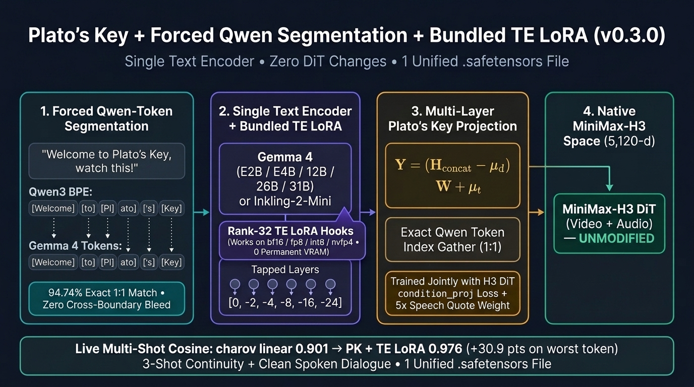

# ComfyUI-H3-Text-Encoders

Drop-in **Plato's Key** text encoder adapters to run modern LLMs/VLMs (**Qwen 3.5**, **Qwen 3.8**, **Google Gemma 4**, **Inkling-2-Mini**, or any HuggingFace `transformers` model) as a conditioning encoder for **MiniMax-H3** (**T2VA**, **FL2VA**, **Ref2VA**) in ComfyUI — **1 single Text Encoder, 1 `.safetensors` key, zero DiT changes**.

All pre-calibrated `.safetensors` keys live on HuggingFace: [**`Alissonerdx/TE-PK-Minimax-H3`**](https://huggingface.co/Alissonerdx/TE-PK-Minimax-H3).

## Which Key Should I Use?

- **Qwen 3.5 / Qwen 3.8 (Recommended #1 — Same Tokenizer, Zero Training):** Download **`*_pk_ridge_*.safetensors`** (`R² 0.985–0.992`).
- **Gemma 4 / Inkling-2-Mini (Cross-Family):**
  - **`*_pk_lora_*.safetensors`** *(Best for speech & multi-shot, requires node **`v0.3.2+`**)* — 1 unified file bundling Forced Qwen-Segmentation + Multi-Layer Plato's Key + Rank-32 TE LoRA (works on `bf16` / `fp8` / `int8` / `nvfp4`).
  - **`*_pk_ridge_charov_*.safetensors`** *(100% zero-training linear, `v0.2.0+`)* — token-level character-overlap alignment.
  - **`*_pk_ridge_4layer_*.safetensors`** *(Legacy word-span linear, `v0.1.8+`)*.



> **Deep-Dive Docs:** [`docs/PK_LORA.md`](docs/PK_LORA.md) (how `pk_lora` & Forced Qwen-Segmentation work) · [`CHAR_OVERLAP_V6.md`](CHAR_OVERLAP_V6.md) (how `charov` `A @ H` works) · [`docs/ENGINEERING_NOTES.md`](docs/ENGINEERING_NOTES.md) (Ridge vs Procrustes, CLIP parity & custom calibration).

---

## Pre-Calibrated Weights & Direct Download Links

### Same-Tokenizer Encoders (Qwen 3.5 / Qwen 3.8 — 1:1 Token Ridge)

| Encoder | ComfyUI Loader | Text Encoder Download | **Val Metrics (`Cos` / `R²`)** | **Key File (`Alissonerdx/TE-PK-Minimax-H3`)** |
|---|---|---|---:|---|
| **Qwen 3.5 9B** ⭐ | `CLIPLoader` + `PlatosKeyPatchCLIP` | [**`Comfy-Org/Qwen3.5`**](https://huggingface.co/Comfy-Org/Qwen3.5/tree/main/text_encoders) (`int8` `9.8 GB` / `bf16` `19.3 GB`) | **93.05%** (`R² 0.9905`) | [`pk_ridge_qwen3.5_9b`](https://huggingface.co/Alissonerdx/TE-PK-Minimax-H3/resolve/main/qwen3.5/minimax_h3_32b_pk_ridge_qwen3.5_9b.safetensors) |
| **Qwen 3.5 2B** | `CLIPLoader` + `PlatosKeyPatchCLIP` | [**`Comfy-Org/Qwen3.5`**](https://huggingface.co/Comfy-Org/Qwen3.5/tree/main/text_encoders) (`bf16` `4.6 GB`) | **92.57%** (`R² 0.9916`) | [`pk_ridge_qwen3.5_2b`](https://huggingface.co/Alissonerdx/TE-PK-Minimax-H3/resolve/main/qwen3.5/minimax_h3_32b_pk_ridge_qwen3.5_2b.safetensors) |
| **Qwen 3.5 4B** | `CLIPLoader` + `PlatosKeyPatchCLIP` | [**`Comfy-Org/Qwen3.5`**](https://huggingface.co/Comfy-Org/Qwen3.5/tree/main/text_encoders) (`bf16` `9.3 GB`) | **91.82%** (`R² 0.9902`) | [`pk_ridge_qwen3.5_4b`](https://huggingface.co/Alissonerdx/TE-PK-Minimax-H3/resolve/main/qwen3.5/minimax_h3_32b_pk_ridge_qwen3.5_4b.safetensors) |
| **Qwen 3.5 0.8B** | `PlatosKeyHFTextEncoderLoader` | [**`Qwen/Qwen3.5-0.8B`**](https://huggingface.co/Qwen/Qwen3.5-0.8B) | **91.11%** (`R² 0.9901`) | [`pk_ridge_qwen3.5_0.8b`](https://huggingface.co/Alissonerdx/TE-PK-Minimax-H3/resolve/main/qwen3.5/minimax_h3_32b_pk_ridge_qwen3.5_0.8b.safetensors) |
| **Qwen 3.8 27B** | `CLIPLoader` + `PlatosKeyPatchCLIP` | [**`Comfy-Org/Qwen3.8-27B`**](https://huggingface.co/Comfy-Org/Qwen3.8-27B/tree/main/text_encoders) (`w4a8` `17.3 GB`) | **89.94%** (`R² 0.9846`) | [`pk_ridge_qwen3.8_27b`](https://huggingface.co/Alissonerdx/TE-PK-Minimax-H3/resolve/main/qwen3.8/minimax_h3_32b_pk_ridge_qwen3.8_27b.safetensors) |

### Cross-Family Encoders (`pk_lora` Unified vs `charov` Zero-Training vs `4layer` Legacy)

| Encoder | ComfyUI Loader | **`pk_lora` Unified (`v0.3.2+`, Best)** | **`charov` Zero-Train (`v0.2.0+`)** | **`4layer` Legacy** |
|---|---|---|---|---|
| **Gemma 4 E4B** 🏆 | `CLIPLoader` + `PlatosKeyPatchCLIP` ([`Comfy-Org/gemma-4`](https://huggingface.co/Comfy-Org/gemma-4/tree/main/text_encoders)) | [`pk_lora_gemma4_e4b`](https://huggingface.co/Alissonerdx/TE-PK-Minimax-H3/resolve/main/gemma4/minimax_h3_32b_pk_lora_gemma4_e4b.safetensors) (**cos 97.6%**, `H3 R² 0.894`) | [`charov_gemma4_e4b`](https://huggingface.co/Alissonerdx/TE-PK-Minimax-H3/resolve/main/gemma4/minimax_h3_32b_pk_ridge_charov_gemma4_e4b.safetensors) (`95.59%`) | [`4layer_gemma4_e4b`](https://huggingface.co/Alissonerdx/TE-PK-Minimax-H3/resolve/main/gemma4/minimax_h3_32b_pk_ridge_4layer_gemma4_e4b.safetensors) (`94.86%`) |
| **Gemma 4 E2B** ⭐ | `CLIPLoader` + `PlatosKeyPatchCLIP` ([`Comfy-Org/gemma-4`](https://huggingface.co/Comfy-Org/gemma-4/tree/main/text_encoders)) | [`pk_lora_gemma4_e2b`](https://huggingface.co/Alissonerdx/TE-PK-Minimax-H3/resolve/main/gemma4/minimax_h3_32b_pk_lora_gemma4_e2b.safetensors) (`cos 96.8%`, `H3 R² 0.864`) | [`charov_gemma4_e2b`](https://huggingface.co/Alissonerdx/TE-PK-Minimax-H3/resolve/main/gemma4/minimax_h3_32b_pk_ridge_charov_gemma4_e2b.safetensors) (`94.77%`) | [`4layer_gemma4_e2b`](https://huggingface.co/Alissonerdx/TE-PK-Minimax-H3/resolve/main/gemma4/minimax_h3_32b_pk_ridge_4layer_gemma4_e2b.safetensors) (`94.46%`) |
| **Gemma 4 12B** | `CLIPLoader` + `PlatosKeyPatchCLIP` ([`Comfy-Org/gemma-4`](https://huggingface.co/Comfy-Org/gemma-4/tree/main/text_encoders)) | *Training now* | [`charov_gemma4_12b`](https://huggingface.co/Alissonerdx/TE-PK-Minimax-H3/resolve/main/gemma4/minimax_h3_32b_pk_ridge_charov_gemma4_12b.safetensors) (`95.26%`) | [`4layer_gemma4_12b`](https://huggingface.co/Alissonerdx/TE-PK-Minimax-H3/resolve/main/gemma4/minimax_h3_32b_pk_ridge_4layer_gemma4_12b.safetensors) (`93.67%`) |
| **Inkling-2-Mini** | `PlatosKeyHFTextEncoderLoader` ([`thinkingmachines/Inkling-2-Mini`](https://huggingface.co/thinkingmachines/Inkling-2-Mini)) | *In queue* | [`charov_inkling2_mini`](https://huggingface.co/Alissonerdx/TE-PK-Minimax-H3/resolve/main/inkling2/minimax_h3_32b_pk_ridge_charov_inkling2_mini.safetensors) (`93.52%`) | [`4layer_inkling2_mini`](https://huggingface.co/Alissonerdx/TE-PK-Minimax-H3/resolve/main/inkling2/minimax_h3_32b_pk_ridge_4layer_inkling2_mini.safetensors) (`96.23%`) |
| **Gemma 4 26B-A4B** | `PlatosKeyHFTextEncoderLoader` ([`google/gemma-4-26B-A4B-it`](https://huggingface.co/google/gemma-4-26B-A4B-it)) | *In queue* | [`charov_gemma4_26b_a4b`](https://huggingface.co/Alissonerdx/TE-PK-Minimax-H3/resolve/main/gemma4/minimax_h3_32b_pk_ridge_charov_gemma4_26b_a4b.safetensors) (`95.32%`) | [`4layer_gemma4_26b_a4b`](https://huggingface.co/Alissonerdx/TE-PK-Minimax-H3/resolve/main/gemma4/minimax_h3_32b_pk_ridge_4layer_gemma4_26b_a4b.safetensors) (`95.43%`) |
| **Gemma 4 31B** 🏆 | `CLIPLoader` + `PlatosKeyPatchCLIP` ([`text_encoders/`](https://huggingface.co/Alissonerdx/TE-PK-Minimax-H3/tree/main/text_encoders)) | *In queue* | [`charov_gemma4_31b`](https://huggingface.co/Alissonerdx/TE-PK-Minimax-H3/resolve/main/gemma4/minimax_h3_32b_pk_ridge_charov_gemma4_31b.safetensors) (`95.90%`) | [`4layer_gemma4_31b`](https://huggingface.co/Alissonerdx/TE-PK-Minimax-H3/resolve/main/gemma4/minimax_h3_32b_pk_ridge_4layer_gemma4_31b.safetensors) (`95.97%`) |

---

## Quick Setup

1. **Install or update (`v0.3.2+`):**
```bash
cd ComfyUI/custom_nodes
git clone https://github.com/alisson-anjos/ComfyUI-H3-Text-Encoders.git
cd ComfyUI-H3-Text-Encoders && pip install -r requirements.txt
```
*(Already installed? Run `git pull` inside `ComfyUI-H3-Text-Encoders` and restart ComfyUI.)*

2. **Place files:**
```text
ComfyUI/models/
├── text_encoders/
│   ├── qwen3.5_9b_int8_convrot.safetensors
│   └── gemma4_e4b_it_fp8_scaled.safetensors
└── clip_projections/
    ├── minimax_h3_32b_pk_ridge_qwen3.5_9b.safetensors
    └── minimax_h3_32b_pk_lora_gemma4_e4b.safetensors
```

3. **Wire in ComfyUI (`strength = 1.00`, `apply_to_pooled = False`):**
   - **Native ComfyUI encoders:** `Load CLIP` → **`Plato's Key Patch CLIP (H3 Plug & Play)`** → `MiniMax H3 Reference to Video` / `MiniMax H3 Image to Video`.
   - **Any HuggingFace model:** **`Plato's Key Load Any HF Text Encoder (H3)`** (`offload_to_cpu = True`) → `MiniMax H3 Reference to Video` / `MiniMax H3 Image to Video`.

---

## Visual Showcases

### Explainer & 3-Way Comparison
[](https://huggingface.co/Alissonerdx/TE-PK-Minimax-H3/resolve/main/showcase/H3_PlatosKey_X_Demo_Final.mp4)

### 4-Way Ref2VA & Pure T2VA Comparison
[](https://huggingface.co/Alissonerdx/TE-PK-Minimax-H3/resolve/main/showcase/H3_PlatosKey_MultiLayer_4Way_Showcase.mp4)

### 10-Second 6-Way Action Stress Test (Qwen + Gemma 4 + Inkling-2-Mini)
[](https://huggingface.co/Alissonerdx/TE-PK-Minimax-H3/resolve/main/showcase/H3_PlatosKey_10s_6Way_Action_Showcase.mp4)

---

## License

Apache 2.0 — see [LICENSE](LICENSE). Inspired by Stanford Hazy Research's [Plato's Key](https://hazyresearch.stanford.edu/blog/2026-11-25-platos-key).
