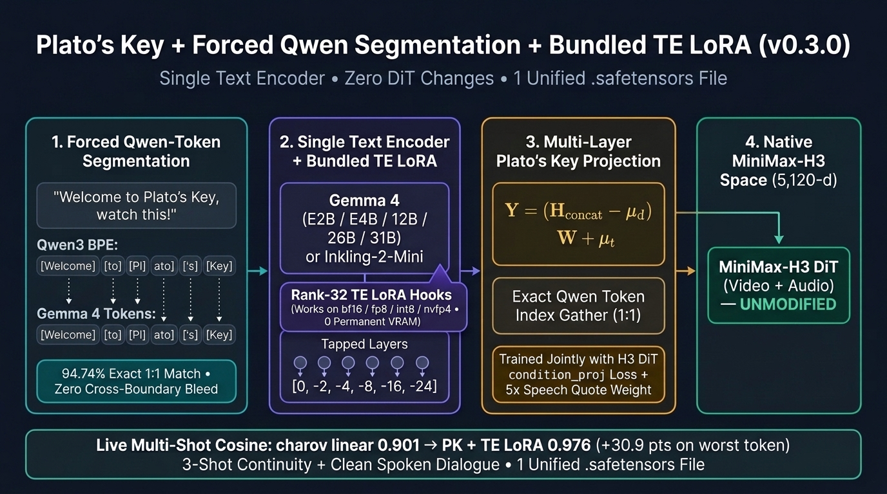

# `pk_lora` Architecture — Forced Qwen-Segmentation + Multi-Layer Plato's Key + Bundled TE LoRA

Cross-family text encoders (such as **Google Gemma 4** SentencePiece or **Inkling-2-Mini**) tokenize prompts differently from MiniMax-H3's native **`Qwen3-VL-32B`** BPE tokenizer. Purely linear cross-tokenizer projections (`charov` / `4layer`) work well for single-shot visuals, but hit a ceiling (`cos ≈ 0.90`) on complex multi-shot prompts and spoken dialogue.

`*_pk_lora_*.safetensors` solves this inside **1 single `.safetensors` file**, using **1 single Text Encoder** and **zero DiT changes**.

## How It Works

1. **Forced Qwen-Token Segmentation (`94.74%` exact 1:1 match on Gemma 4):**
   - The prompt is first tokenized with Qwen3's BPE tokenizer (`<1 ms` CPU, `0 VRAM`).
   - Each Qwen subword piece is encoded independently with the donor tokenizer so every Qwen token boundary is an exact donor token boundary (eliminating cross-boundary subword bleed).
   - After the forward pass, the hidden state at the last donor sub-token of each Qwen piece is selected, yielding an exact `[B, T_qwen, D]` grid.

2. **Bundled Rank-32 Text Encoder LoRA (`te_lora.*`):**
   - A lightweight Rank-32 LoRA is stored inside the same `.safetensors` file alongside the Plato's Key weights (`has_te_lora = "true"`).
   - At inference time, ComfyUI applies the LoRA via temporary PyTorch forward hooks on the language-model linear layers (skipping vision/audio towers) and removes them immediately after encoding.
   - Because hooks operate on activations rather than merging into base weights, the **same single `.safetensors` file** works identically on **`bf16`**, **`fp8_scaled`**, **`int8_convrot`**, **`w4a8`**, and **`nvfp4`** with **zero permanent VRAM overhead**.

3. **Multi-Layer Plato's Key Projection:**
   - Hidden states from 5–6 intermediate layers (including `layer 0` lexical embeddings) are concatenated and projected into MiniMax-H3's native **5,120-dim `Qwen3-VL-32B` (layer 49)** space.
   - Stage 1 initializes the projection with exact closed-form ForcedSeg-20k Ridge; Stage 2 jointly optimizes the LoRA + projection with MiniMax-H3's `condition_proj` functional loss and `5×` weighting on quoted spoken dialogue.

## Automatic `inject_token0_sink` Toggle (`v0.3.3+`, ON by default)

Both `PlatosKeyPatchCLIP` and `PlatosKeyHFTextEncoderLoader` include **`inject_token0_sink`** (default **`True`**):
- Native `Qwen3-VL-32B` layer 49 places a large, near-constant Attention Sink vector on Token 0 (`rms ≈ 224`, `cos = 0.99998` across 8,000 prompts).
- Restoring this 20 KB vector in `<0.01 ms` (matching MiniMax's own `TextConnector.sink_embedding`) eliminates clipped/unfinished opening words at the start of generated videos across **all** H3 keys (`Qwen 3.5`, `Qwen 3.8`, `Gemma 4`, `Inkling-2-Mini`).
- Can be toggled **`False`** anytime if you prefer legacy un-injected behavior.
